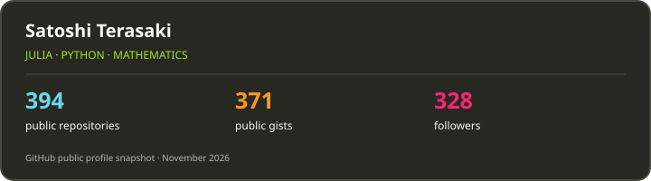

### Hi there 👋

<!--
**terasakisatoshi/terasakisatoshi** is a ✨ _special_ ✨ repository because its `README.md` (this file) appears on your GitHub profile.

Here are some ideas to get you started:

- 🔭 I’m currently working on ...
- 🌱 I’m currently learning ...
- 👯 I’m looking to collaborate on ...
- 🤔 I’m looking for help with ...
- 💬 Ask me about ...
- 📫 How to reach me: ...
- 😄 Pronouns: ...
- ⚡ Fun fact: ...
-->

### Web pages

- 🌐 [Personal website](https://terasakisatoshi.github.io/)
- 📚 [MathSeminar.jl](https://terasakisatoshi.github.io/MathSeminar.jl/) — topics in mathematics with Julia

### Projects

<h3> 2026 (click here)</h3>

#### terasakisatoshi

- [terasakisatoshi/sarashina-arxiv-rag](https://github.com/terasakisatoshi/sarashina-arxiv-rag)
- [terasakisatoshi/poisson_eq_jacobi_benchmark](https://github.com/terasakisatoshi/poisson_eq_jacobi_benchmark)
- [terasakisatoshi/MvNormalBenchmark](https://github.com/terasakisatoshi/MvNormalBenchmark)
- [terasakisatoshi/jlw_example](https://github.com/terasakisatoshi/jlw_example)
- [terasakisatoshi/tsuru](https://github.com/terasakisatoshi/tsuru)
- [terasakisatoshi/poisson_eq_sandbox](https://github.com/terasakisatoshi/poisson_eq_sandbox)
- [terasakisatoshi/WarmTestRunner.jl](https://github.com/terasakisatoshi/WarmTestRunner.jl)
- [terasakisatoshi/CxxFork.jl](https://github.com/terasakisatoshi/CxxFork.jl)
- [terasakisatoshi/MeetingCaptionTranslator](https://github.com/terasakisatoshi/MeetingCaptionTranslator)
- [terasakisatoshi/EMLRegression.jl](https://github.com/terasakisatoshi/EMLRegression.jl)
- [terasakisatoshi/JuliaIME](https://github.com/terasakisatoshi/JuliaIME)
- [terasakisatoshi/agents-skills-for-japanese](https://github.com/terasakisatoshi/agents-skills-for-japanese)
- [terasakisatoshi/HelloWorldMPIRust.jl](https://github.com/terasakisatoshi/HelloWorldMPIRust.jl)
- [terasakisatoshi/rsmpi_sandbox](https://github.com/terasakisatoshi/rsmpi_sandbox)
- [terasakisatoshi/HelloWorldMPIRust_jll.jl](https://github.com/terasakisatoshi/HelloWorldMPIRust_jll.jl)

#### AtelierArith

- [AtelierArith/HFTokenizers.jl](https://github.com/AtelierArith/HFTokenizers.jl)
- [AtelierArith/QwenDecisionCore.jl](https://github.com/AtelierArith/QwenDecisionCore.jl)
- [AtelierArith/tenferro-decision-rs](https://github.com/AtelierArith/tenferro-decision-rs)
- [AtelierArith/KevClient.jl](https://github.com/AtelierArith/KevClient.jl)
- [AtelierArith/JeffClient.jl](https://github.com/AtelierArith/JeffClient.jl)
- [AtelierArith/QuantumEnvelopingAlgebras.jl](https://github.com/AtelierArith/QuantumEnvelopingAlgebras.jl)
- [AtelierArith/MinGWToolchain.jl](https://github.com/AtelierArith/MinGWToolchain.jl)
- [AtelierArith/Laya.jl](https://github.com/AtelierArith/Laya.jl)
- [AtelierArith/JevClient.jl](https://github.com/AtelierArith/JevClient.jl)
- [AtelierArith/PythonRNGs.jl](https://github.com/AtelierArith/PythonRNGs.jl)
- [AtelierArith/AtelierArith_JuliaCon2026_talk](https://github.com/AtelierArith/AtelierArith_JuliaCon2026_talk)
- [AtelierArith/tenferro-rs-deepseek-pr](https://github.com/AtelierArith/tenferro-rs-deepseek-pr)
- [AtelierArith/PlatonicSolidsGenerator.jl](https://github.com/AtelierArith/PlatonicSolidsGenerator.jl)
- [AtelierArith/atelier-arith-julia-development-skills](https://github.com/AtelierArith/atelier-arith-julia-development-skills)
- [AtelierArith/LMStudioClient.jl](https://github.com/AtelierArith/LMStudioClient.jl)
- [AtelierArith/julia-vm-oss](https://github.com/AtelierArith/julia-vm-oss)
- [AtelierArith/pick-typst-oss](https://github.com/AtelierArith/pick-typst-oss)
- [AtelierArith/better-pluto-client](https://github.com/AtelierArith/better-pluto-client)
- [AtelierArith/SubsetJuliaVMSupportRepository](https://github.com/AtelierArith/SubsetJuliaVMSupportRepository)
- [AtelierArith/RustCall.jl](https://github.com/AtelierArith/RustCall.jl)
- [AtelierArith/RustToolChainExamples.jl](https://github.com/AtelierArith/RustToolChainExamples.jl)
- [AtelierArith/CompPhysHack2026HandsOn](https://github.com/AtelierArith/CompPhysHack2026HandsOn)

<h3> 2025 (click here)</h3>

- Activities in AtelierArith

- [AtelierArith/DocumenterTranslationOpenAIBackend.jl](https://github.com/AtelierArith/DocumenterTranslationOpenAIBackend.jl)
- [AtelierArith/MethodExplorer.jl](https://github.com/AtelierArith/MethodExplorer.jl)

- [AtelierArith/rust-random-logo](https://github.com/AtelierArith/rust-random-logo)

- [AtelierArith/DocstringTranslation.jl](https://github.com/AtelierArith/DocstringTranslation.jl)
- [AtelierArith/DocstringTranslationOllamaBackend.jl](https://github.com/AtelierArith/DocstringTranslationOllamaBackend.jl)

- [AtelierArith/DocstringTranslationExoBackend.jl](https://github.com/AtelierArith/DocstringTranslationExoBackend.jl)
- [AtelierArith/DocstringTranslationGoogleTransBackend.jl](https://github.com/AtelierArith/DocstringTranslationGoogleTransBackend.jl)

<h3> 2024 (click here)</h3>

- [terasakisatoshi/TypingSVG.jl](https://github.com/terasakisatoshi/TypingSVG.jl)

- [terasakisatoshi/jldev_jluna](https://github.com/terasakisatoshi/jldev_jluna)
- [terasakisatoshi/MyCling.jl](https://github.com/terasakisatoshi/MyCling.jl)

- Activities in AtelierArith

- [AtelierArith/TerminalSystemMonitor.jl](https://github.com/AtelierArith/TerminalSystemMonitor.jl)

- [AtelierArith/MacOSIOReport.jl](https://github.com/AtelierArith/MacOSIOReport.jl)

- [AtelierArith/PlutoMonacoEditor.jl](https://github.com/AtelierArith/PlutoMonacoEditor.jl)

- [AtelierArith/PlutoMonacoDiffViewer.jl](https://github.com/AtelierArith/PlutoMonacoDiffViewer.jl)
- [AtelierArith/PkgBump.jl](https://github.com/AtelierArith/PkgBump.jl)

- [AtelierArith/QuartzGetWindow.jl](https://github.com/AtelierArith/QuartzGetWindow.jl)
- [AtelierArith/DocstringAsImage.jl](https://github.com/AtelierArith/DocstringAsImage.jl)

- [AtelierArith/TerminalGat.jl](https://github.com/AtelierArith/TerminalGat.jl)

- [AtelierArith/DocstringChef.jl](https://github.com/AtelierArith/DocstringChef.jl)

- [AtelierArith/CarbonNowCLI.jl](https://github.com/AtelierArith/CarbonNowCLI.jl)
- [AtelierArith/PlutoEditorColorThemes.jl](https://github.com/AtelierArith/PlutoEditorColorThemes.jl)

- [AtelierArith/TabNineCompletion.jl](https://github.com/AtelierArith/TabNineCompletion.jl)
- [AtelierArith/dart-random-logo](https://github.com/AtelierArith/dart-random-logo)

- [AtelierArith/CxxRandomLogo](https://github.com/AtelierArith/CxxRandomLogo)
- [AtelierArith/EasyEigenInterface.jl](https://github.com/AtelierArith/EasyEigenInterface.jl)

- [AtelierArith/OmikujiWorkflow.jl](https://github.com/AtelierArith/OmikujiWorkflow.jl)
- [AtelierArith/OkinawaCompPhysFoodSurvey2024.jl](https://github.com/AtelierArith/OkinawaCompPhysFoodSurvey2024.jl)

<h3> 2023 (click here)</h3>

- [terasakisatoshi/jldev_rye](https://github.com/terasakisatoshi/jldev_rye)
- [terasakisatoshi/WitchViewer.jl](https://github.com/terasakisatoshi/WitchViewer.jl)

- [terasakisatoshi/Sacabambaspis.jl](https://github.com/terasakisatoshi/Sacabambaspis.jl)
- [terasakisatoshi/Cerastes.jl](https://github.com/terasakisatoshi/Cerastes.jl)

- [terasakisatoshi/Parsley.jl](https://github.com/terasakisatoshi/Parsley.jl)
- [terasakisatoshi/MojiMoji.jl](https://github.com/terasakisatoshi/MojiMoji.jl)

- Activities in AtelierArith

- [AtelierArith/julia_tutorial](https://github.com/AtelierArith/julia_tutorial)

- [AtelierArith/Lamp.jl](https://github.com/AtelierArith/Lamp.jl)
- [AtelierArith/RandomLogos.jl](https://github.com/AtelierArith/RandomLogos.jl)

- [AtelierArith/SegRCDB.jl](https://github.com/AtelierArith/SegRCDB.jl)
- [AtelierArith/VisualAtom.jl](https://github.com/AtelierArith/VisualAtom.jl)

- [AtelierArith/Kyuri.jl](https://github.com/AtelierArith/Kyuri.jl)

<h3> 2022 (click here)</h3>

- [terasakisatoshi/PCRP.jl](https://github.com/terasakisatoshi/PCRP.jl)
- [terasakisatoshi/TweetPlots.jl](https://github.com/terasakisatoshi/TweetPlots.jl)

- [terasakisatoshi/QuartzGetWindow.jl](https://github.com/terasakisatoshi/QuartzGetWindow.jl)

- Activities in AtelierArith

- [AtelierArith/Kyulacs.jl](https://github.com/AtelierArith/Kyulacs.jl)
- [AtelierArith/PyPlotly.jl](https://github.com/AtelierArith/PyPlotly.jl)
- [AtelierArith/GomalizingFlow.jl](https://github.com/AtelierArith/GomalizingFlow.jl)

<h3> 2021 (click here)</h3>

### 2021

- [terasakisatoshi/MyTemplate.jl](https://github.com/terasakisatoshi/MyTemplate.jl)
- [terasakisatoshi/sysimage_creator](https://github.com/terasakisatoshi/sysimage_creator)

- [terasakisatoshi/MyPlutoflow.jl](https://github.com/terasakisatoshi/MyPlutoflow.jl)
- [terasakisatoshi/streamlit_handwritten_recognition](https://github.com/terasakisatoshi/streamlit_handwritten_recognition)

- [terasakisatoshi/binder_docker_playground](https://github.com/terasakisatoshi/binder_docker_playground)
- [terasakisatoshi/MyVSCodeWorkspace.jl](https://github.com/terasakisatoshi/MyVSCodeWorkspace.jl)

- [terasakisatoshi/jldev_poetry](https://github.com/terasakisatoshi/jldev_poetry)

<h3> 2020 (click here)</h3>

# JuliaLang

- [terasakisatoshi/OpenCVBuilder.jl](https://github.com/terasakisatoshi/OpenCVBuilder.jl)
- [terasakisatoshi/ImageProcessing.jl](https://github.com/terasakisatoshi/ImageProcessing.jl)

- [terasakisatoshi/MatPlotWrap.jl](https://github.com/terasakisatoshi/MatPlotWrap.jl)
- [terasakisatoshi/CallJ.jl](https://github.com/terasakisatoshi/CallJ.jl)

- [terasakisatoshi/wasm_with_julia](https://github.com/terasakisatoshi/wasm_with_julia)
- [terasakisatoshi/MyGenieExample.jl](https://github.com/terasakisatoshi/MyGenieExample.jl)

# Deep Learning

- This project was done when I was working at [Idein Inc.](https://idein.jp/en/)

- [Idein/chainer-hand-pose](https://github.com/Idein/chainer-hand-pose)

